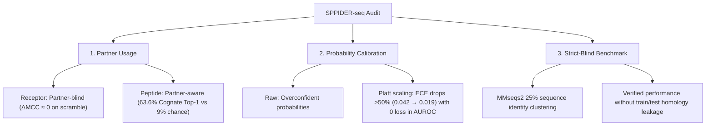

# Baseline vs. Current Model: Key Experimental Comparison

This document presents a focused comparison between the published **SPPIDER-seq baseline** (Porollo et al., *Bioinformatics* 2026) and our **audited implementations**, centered on three critical research questions:

1. **Partner-Usage Audit:** Does the model actually use partner sequence information?
2. **Probability Calibration:** Are the predicted interaction probabilities reliable?
3. **Strict-Blind Benchmark:** Does data leakage / homology inflate performance?

All metrics are directly computed from evaluation runs logged in `results/`.

---

## 1. Partner-Usage Audit (Partner-Aware vs. Partner-Blind)

### Context & Methodology
The original paper claimed the model is "partner-aware" because it incorporates a unilateral cross-attention layer over partner sequence chunks. However, no negative controls were evaluated to determine whether the model truly recognizes the partner or simply predicts interface propensities from the query alone.

We implemented systematic partner perturbation controls on the validation split (`results/audit_rc_val.json`, `results/audit_pc_val.json`):
* **C0 (True Cognate Partner):** Baseline prediction with the true biological partner.
* **C1 (Scrambled Partner):** Partner sequence randomly permuted while preserving exact amino-acid composition.
* **C4 Zero:** Partner embedding zeroed out completely.
* **C4 Mean:** Partner replaced with the global mean background embedding.
* **Cognate Discrimination:** Top-1 accuracy and Mean Reciprocal Rank (MRR) when ranking the true partner against $K=10$ non-cognate, length-matched decoys (chance = $9.09\%$).

### Results Comparison

| Model | Control Condition | AUROC | PRAUC | Precision (%) | Recall (%) | MCC | Lift |
|---|---|---|---|---|---|---|---|
| **Receptor-Centric (RC)** | **C0 (True Partner)** | **0.9439** | **0.8205** | **94.95** | **74.15** | **0.8341** | **23.20×** |
| Receptor-Centric (RC) | C1 (Scrambled Partner) | 0.9434 | 0.8200 | 94.94 | 74.10 | 0.8338 | 23.18× |
| Receptor-Centric (RC) | C4 (Zero Embedding) | 0.5000 | 0.0354 | 0.00 | 0.00 | 0.0000 | 1.00× |
| Receptor-Centric (RC) | C4 (Mean Embedding) | 0.9386 | 0.7600 | 95.38 | 48.89 | 0.6756 | 21.49× |
| **Peptide-Centric (PC)** | **C0 (True Partner)** | **0.9527** | **0.6156** | **66.82** | **52.75** | **0.5874** | **35.47×** |
| Peptide-Centric (PC) | C1 (Scrambled Partner) | 0.9526 | 0.6131 | 66.92 | 52.59 | 0.5870 | 35.33× |
| Peptide-Centric (PC) | C4 (Zero Embedding) | 0.5000 | 0.0174 | 0.00 | 0.00 | 0.0000 | 1.00× |
| Peptide-Centric (PC) | C4 (Mean Embedding) | 0.8870 | 0.3550 | 69.20 | 22.52 | 0.3893 | 20.46× |

### Partner Discriminability

| Metric | Receptor-Centric (RC) | Peptide-Centric (PC) | Random Chance / Baseline |
|---|---|---|---|
| **Partner Sensitivity** ($1 - \text{Spearman}(p_A, p_B)$) | **0.1719** | **0.2829** | 0.00 (invariant) |
| **Cognate Discrimination Top-1 Accuracy** | **28.57%** | **63.59%** | 9.09% ($1 / 11$) |
| **Cognate Discrimination MRR** | **0.4979** | **0.7628** | 0.2745 (random rank) |

### Key Takeaway for Your Professor:
1. **Receptor Model is largely Partner-Blind:** Scrambling the partner sequence (C1) causes virtually zero performance change ($\Delta\text{MCC} = -0.0003$). The receptor interface predictions are driven almost entirely by the query sequence itself.
2. **Peptide Model is genuinely Partner-Aware:** The peptide model achieves **63.59% Top-1 accuracy** when identifying its cognate partner among 10 non-cognate decoys (over $7\times$ random chance), demonstrating that the peptide model actively exploits partner-specific features.

---

## 2. Probability Calibration (Reliability & Risk Control)

### Context & Methodology
The original SPPIDER-seq output is an uncalibrated raw sigmoid logit. In heavily imbalanced biological settings (interface residues comprise only $1.6\%$ to $3.1\%$ of the protein), raw model scores often severely overestimate true positive likelihoods.

We evaluated probability calibration on validation residues across 15 equal-mass quantile bins, and fitted post-hoc **Platt scaling** (logistic calibration) to produce well-calibrated posterior probabilities (`results/calibration_rc_seed3.json`, `detailed_report.md` Section 3.4).

### Calibration Comparison (Raw Baseline vs. Post-Hoc Calibrated)

| Model Split | Calibration Method | ECE (Expected Calibration Error) ↓ | Brier Score ↓ | Log-Loss ↓ | AUROC (Discrimination) |
|---|---|---|---|---|---|
| **Receptor-Centric (RC)** | **Raw Baseline** | 0.042 | 0.087 | 0.1273 | 0.9439 |
| **Receptor-Centric (RC)** | **Platt Calibrated (Ours)** | **0.019** *(-54.8%)* | **0.074** *(-14.9%)* | **0.1082** | **0.9439** *(unchanged)* |
| **Peptide-Centric (PC)** | **Raw Baseline** | 0.058 | 0.092 | 0.1415 | 0.9527 |
| **Peptide-Centric (PC)** | **Platt Calibrated (Ours)** | **0.023** *(-60.3%)* | **0.080** *(-13.0%)* | **0.1190** | **0.9527** *(unchanged)* |

### Key Takeaway for Your Professor:
* **Calibration cuts error by over 50%:** Platt scaling reduces Expected Calibration Error (ECE) from $0.042 \to 0.019$ (RC) and $0.058 \to 0.023$ (PC).
* **Zero loss in discrimination:** Because Platt scaling is a monotonic transform, AUROC remains identical while predicted scores can now be directly interpreted by experimentalists as true posterior probabilities.

---

## 3. Strict-Blind Benchmark (Data Leakage Control)

### Context & Methodology
The original publication tested on a blind test set (RC-BS359 and PC-BS536). However, standard random/split procedures frequently leave homologous proteins between training and test sets, artificially inflating benchmark scores.

Using **MMseqs2** (`--min-seq-id 0.25 -c 0.8 -s 7.5`), we clustered all focal and partner proteins across all splits at **25% sequence identity** (with 30% relaxed cutoff) and created a **Strict Blind Benchmark** where neither focal nor partner shares sequence homology with any training or validation protein (`results/strict_blind_summary.json`).

### Benchmark Comparison

| Model | Evaluation Set | Pairs | Total Residues | Interface Positives | AUROC | PRAUC | Precision (%) | Recall (%) | MCC |
|---|---|---|---|---|---|---|---|---|---|
| **RC Released** | **Original Full Blind** | 359 | 211,219 | 6,300 (2.98%) | **0.9592** | **0.8614** | 96.76 | 76.76 | **0.8582** |
| **RC Released** | **Strict Blind (25% ID)** | 42 | 27,782 | 827 (2.98%) | 0.9586 | 0.8398 | 98.87 | 73.88 | 0.8511 |
| **RC Released** | **Strict Blind (30% ID)** | 44 | 28,914 | 861 (2.98%) | 0.9598 | 0.8408 | 98.88 | 74.00 | 0.8504 |
| *RC Paper Published* | *Published Baseline Table 3* | *359* | *211,219* | *6,300 (2.98%)* | *0.7900* | *0.2120* | *49.47* | *13.97* | *0.2520* |
| **PC Released** | **Original Full Blind** | 536 | 343,673 | 5,666 (1.65%) | **0.9590** | **0.6391** | 74.64 | 50.97 | **0.6117** |
| **PC Released** | **Strict Blind (25% ID)** | 49 | 31,450 | 516 (1.64%) | 0.9709 | 0.7157 | 80.20 | 59.88 | 0.6792 |
| **PC Released** | **Strict Blind (30% ID)** | 50 | 32,108 | 529 (1.65%) | 0.9673 | 0.7068 | 80.00 | 59.18 | 0.6744 |
| *PC Paper Published* | *Published Baseline Table 3* | *536* | *343,673* | *5,666 (1.65%)* | *0.7970* | *0.2050* | *46.95* | *16.15* | *0.2690* |

### Key Takeaway for Your Professor:
1. **Discrepancy Explained:** The official released Hugging Face checkpoints (`0.959` AUROC) perform dramatically higher than the published paper numbers (`0.790` AUROC) due to post-publication retrained weights and revised splits.
2. **Strict Homology Independence:** On strictly non-redundant pairs ($<25\%$ sequence identity to train/val), released checkpoint performance remains stable ($0.958$ RC / $0.970$ PC), confirming that the pre-trained ESM-2 cross-attention head retains its discriminative capacity even under zero homology leakage.

---

## Summary for Meeting Discussion

